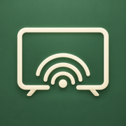
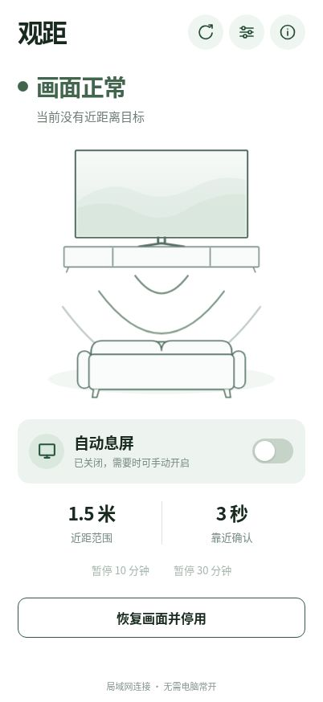

**English** | [简体中文](README.zh-CN.md)

<p align="center"></p>

# Guanju · 观距

**Too close? Picture off. Step back? Picture back.** An ESP32-C3 and a millimeter-wave radar add a distance reminder to a compatible Sony BRAVIA TV. Check status and adjust settings from your phone on the local network.

This is an independent radar-based distance assistant. The controller, web interface and settings storage run on the ESP32. Once configured, it needs continuous USB power and a working local network; no always-on computer, AI agent, Home Assistant or cloud service is required. **The device web interface is currently in Chinese.** This repository provides English and Simplified Chinese documentation.

<p align="center"></p>

[Get started](docs/en/getting-started.md) · [Hardware and wiring](docs/en/hardware.md) · [Set up with an AI agent](docs/en/ai-assisted-setup.md) · [TV compatibility](docs/en/compatibility.md) · [MIT license](LICENSE)

## Features

- Turns the TV picture off when a valid nearby target remains within the configured distance for the confirmation period. Restores the picture it turned off when the target leaves the near zone; TV power stays on.
- Saves your automation preference. Standby pauses monitoring; switching the TV back on resumes it when the device is healthy. The controller never wakes or powers on the TV.
- Hosts a phone-friendly web interface with a single-screen home view, animated status scene, settings panel, reset to defaults and manual picture recovery. Supports adding a shortcut to the iPhone Home Screen; the refresh button reloads the entire page.
- Offers adjustable distance, approach confirmation, radar absence delay, recovery confirmation and three sensitivity profiles. Settings take effect only after verified radar readback and successful persistence.
- Uses USB for the first installation and supports subsequent updates over local Wi-Fi. Web assets and icons are embedded in the firmware, with no CDN dependency.

**TV compatibility:** The current adapter uses Sony BRAVIA's `/sony/system` IP control API. Availability depends on the TV model, API and permissions. Not all Sony TVs have been verified, and other brands are not implemented. Check [compatibility](docs/en/compatibility.md) before purchasing hardware.

**Detection limits:** The radar reports target presence and distance information. It cannot identify a child, determine left/right coordinates or recognize posture. Very close targets, edge positions, stationary people, multiple targets and environmental reflections can affect detection. The people and waves on screen are illustrations of state. This DIY reminder does not replace supervision or eye-care measures.

## What to buy

| Item | Reference model or requirement | Quantity |
| --- | --- | --- |
| Millimeter-wave radar | Hi-Link **HLK-LD2410C**, with soldered header pins | 1 |
| Controller | Waveshare **ESP32-C3-Zero-M**; `-M` has pre-soldered headers | 1 |
| Jumper wires | Female-to-female Dupont wires | 4 |
| USB cable | USB-C **data cable**; a charge-only cable cannot flash the board | 1 |
| Power supply | Stable 5V USB supply | 1 |
| Enclosure and mounting | Nonmetallic plastic box and insulating mounting materials | As needed |

See the [hardware guide](docs/en/hardware.md) for official purchase links, model differences, power and pin checks. A ready-made plastic project box is sufficient; no 3D printer is required. See [enclosure and mounting](docs/en/enclosure.md).

## Wiring overview

**Disconnect USB power before wiring. Follow the labels on the actual boards, not wire colors or an assumed pin order.**

| LD2410C | ESP32-C3-Zero-M |
| --- | --- |
| VCC | 5V |
| GND | GND |
| TX | GPIO20 / RX |
| RX | GPIO21 / TX |
| OUT | Leave disconnected |


The original illustration is in Chinese. It shows **logical connections, not the physical header order**. Follow the table above and the [full wiring instructions](docs/en/hardware.md) to identify the pins and check power safely.

## Build your own

1. [Check the TV API](docs/en/compatibility.md), obtain the hardware and wire it with power disconnected.
2. [Prepare your computer](docs/en/getting-started.md): Python 3.12–3.14, preferably 3.13, and the pinned ESPHome version.
3. Copy `firmware/secrets.example.yaml` to local `firmware/secrets.yaml`. Enter your **2.4GHz Wi-Fi** credentials, fallback access-point password, TV address and PSK. This file is ignored by Git; never paste it into an AI chat or issue.
4. Follow the tutorial to identify the correct USB serial port. Verify the radar using the observer firmware before compiling and flashing `firmware/tv-trial.yaml`.
5. Connect your phone to the same local network and open `http://tv-radar.local/`. If mDNS does not resolve, use the device IP from the router or USB logs.
6. Keep automation off while checking radar, TV and settings status. Then enable it and calibrate near, far and left/right seating positions in the actual room.
7. Follow [maintenance and Wi-Fi updates](docs/en/maintenance.md) for future changes; the controller does not need to remain plugged into your computer.

New to development boards, or working with Codex, Claude Code or Cursor? The [AI-assisted setup guide](docs/en/ai-assisted-setup.md) contains staged prompts. The agent reads the repository and assists with local tools; you fill in secrets privately and confirm the actual hardware before flashing.

## Default settings

| Setting | Default | Adjustable range |
| --- | --- | --- |
| Software near-distance threshold | 1.5 m | 0.5–3.0 m in 0.1 m steps |
| Approach confirmation | 3 s | 1–5 s |
| Radar absence delay | 1 s | 1 or 2 s |
| Application recovery confirmation | 1 s | 1 or 2 s |
| Sensitivity | Standard | Low / Standard / High |

Absence delay and recovery confirmation add up, with additional network, polling and TV execution time. Recovery within a fixed time cannot be guaranteed during faults. The radar's nominal observation range of about 6 m helps distinguish distant targets from absence; **it does not mean everyone within 6 m triggers picture-off**. See [usage and calibration](docs/en/usage.md).

## Documentation

| Task | English | 简体中文 |
| --- | --- | --- |
| Purchase hardware and connect the pins | [Hardware and wiring](docs/en/hardware.md) | [硬件采购与接线](docs/hardware.md) |
| Choose an enclosure and mount the boards | [Enclosure](docs/en/enclosure.md) | [外壳与安装](docs/enclosure.md) |
| Install dependencies, flash over USB and connect Wi-Fi | [Getting started](docs/en/getting-started.md) | [从零安装](docs/getting-started.md) |
| Work with Codex or another agent | [AI-assisted setup](docs/en/ai-assisted-setup.md) | [AI 协作安装](docs/ai-assisted-setup.md) |
| Tune settings and add an iPhone shortcut | [Usage and calibration](docs/en/usage.md) | [使用与校准](docs/usage.md) |
| Update over Wi-Fi and recover from faults | [Maintenance](docs/en/maintenance.md) | [维护说明](docs/maintenance.md) |
| Check whether a TV can work | [Compatibility](docs/en/compatibility.md) | [兼容性](docs/compatibility.md) |
| Understand the state machine, threads and API | [Architecture](docs/en/architecture.md) | [架构](docs/architecture.md) |
| Preview the web interface on your computer | [Local UI preview](docs/en/development-ui.md) | [本地 UI 预览](docs/development-ui.md) |
| Contribute changes | [Contributing](CONTRIBUTING.md) | [贡献指南](CONTRIBUTING.zh-CN.md) |
| Publish the repository on GitHub | [Publishing handoff](docs/en/publishing.md) | [发布交接](docs/publishing.md) |

AI coding agents should also read [AGENTS.md](AGENTS.md), the canonical project instructions, currently written in Chinese. Each translated guide links to its counterpart at the top. Language links switch repository documents; they do not change the language of the device interface.

## Development checks

```sh
python -m venv .venv
# macOS/Linux: source .venv/bin/activate
# Windows PowerShell: .venv\Scripts\Activate.ps1
python -m pip install -r requirements.txt
python tools/verify_project.py --config
```

Checks also require Node.js 22, POSIX `sh` and a C++17 compiler with ASan/UBSan support. WSL2 is recommended for the complete development checks on Windows; native Windows USB flashing is covered in the setup guide. These checks do not connect to or flash hardware. `--config` validates temporary copies with example secrets, without overwriting your private configuration. CI uses the same checks; hosted CI results must be confirmed after publication.

## Network, license and project status

The web/REST interface and default native OTA have no authentication. Use only on a trusted local network; **do not expose device ports to the internet**. See [security](SECURITY.md) for optional OTA authentication and handling secrets and build artifacts. Personal firmware contains network and TV credentials and is not distributed here as a binary download.

Project source, documentation and original illustrations are available under the [MIT license](LICENSE). ESPHome, ESP-IDF and other dependencies retain their own licenses; distributing a complete firmware requires considering those components too. See [third-party notices](THIRD_PARTY_NOTICES.md).

This project grew from hands-on use with one ESP32-C3-Zero-M, LD2410C and Sony TV. Those results do not establish compatibility with every TV, network or mounting position. See the [changelog](CHANGELOG.md) for verification scope and remaining limitations.
