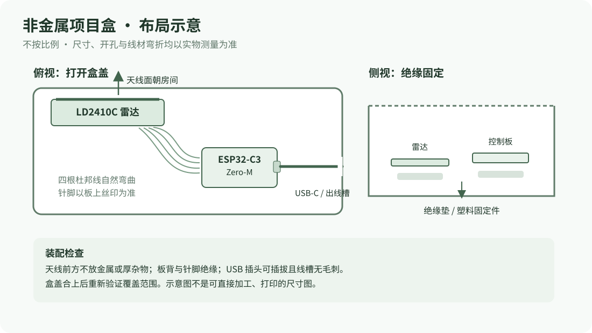

[English](en/enclosure.md) | [简体中文](enclosure.md)

# 装盒与安装

优先使用现成的 **ABS 或其他非金属塑料项目盒**，无需 3D 打印。以下是装配方法和概念布局，**不是经过实物适配验证的外壳或加工图**。

## 选盒和试摆

1. 断开 USB 电源，保持两块板的接线完好。把控制板、雷达和四根线平放在桌上，确认雷达天线面朝向待检测的房间，控制板 USB-C 口朝可插线的一侧。
2. 测量两块板加上排针、母头、杜邦线自然弯折后的**总长、总宽、最高处**，再为盒壁、固定件、插拔和导线留余量。可从标称内尺寸约 **100 × 70 × 35 mm** 的塑料项目盒开始筛选；这只是选购参考，不是已验证可用尺寸。商家标的外尺寸与内尺寸、螺柱和实际线头可能差很多，购买前仍需核对。
3. 试摆时避免弯折挤压导线，不让针脚、金属焊点或板背面互相碰触。USB-C 插头应能完整插到底并方便拔下，盒盖合上时不应压到线或板。

## 固定与出线

1. 在断电状态下按实物确定 USB-C 开口或线槽位置；开孔时先移走电子板和导线，清理毛刺和碎屑后再装回。孔大小以实际 USB 插头为准，不要照示意图量尺寸。
2. 用绝缘垫、塑料支柱或适合该盒的固定材料固定板背面，保证焊点、排针与盒内其他部件绝缘；不要用会导电的材料压住电路。固定雷达时不遮挡天线面，不把胶带或金属固定件覆盖在天线上。
3. 杜邦线留自然弯曲余量并做适当固定，避免拉动 USB 电源线时把线头拽松；线槽边缘加绝缘保护。盖好盒子前再按 [接线表](hardware.md#断电接线) 核对四根线与 OUT 留空。
4. 合盖后重新通电，按 [首次安装](getting-started.md) 与 [使用和校准](usage.md) 验证雷达及网页。不要只凭控制板亮灯判断。

## 放置与验证

- 雷达天线面朝房间里需要观察的区域，尽量正对电视前方中心；确认模块正面请参照 [海凌科官方产品资料](https://www.hlktech.com/Goods-239.html) 和实物，不要只按示意图猜针脚方向。
- 不使用金属盒，也不要让天线前方被电视金属背板、金属支架或厚杂物遮挡。使用非金属盒并不保证射频不受影响：盒壁材质、厚度、内部走线和安装位置都可能改变实际表现，须合盖实测。
- 不让裸板或焊点直接接触电视金属外壳；固定可靠，避免跌落、导线受拉，以及堵住电视自身散热空间。
- 中心、左右边缘分别从远处靠近并离开，再测静止、多人、蹲下及贴近屏幕；尤其检查超近与边缘盲区。雷达无法识别儿童身份，界面人物仅是目标示意，不可当作认证安全保护。
- 雷达硬件观察 gate 8 的名义最远范围约 6 m；软件近距阈值默认 1.5 m，实际覆盖会受环境影响。不要把名义数字当作实测覆盖边界。详情见 [硬件与范围](hardware.md#范围与实际局限)。

本示意未经过打样、实际盒内安装或 3D 打印验证；应按自己购买的盒子和线材实测调整。接线和盒体都应可拆，以便将来 USB 恢复与维护。
