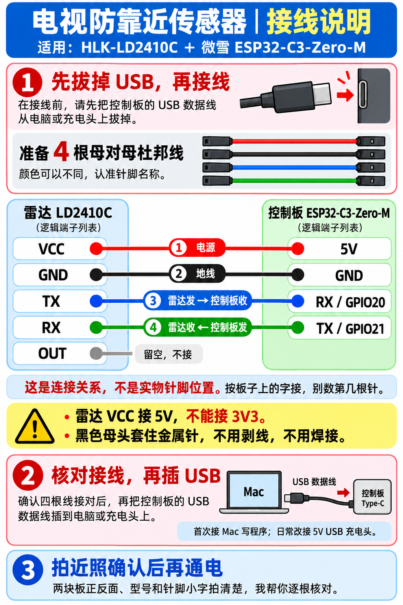

# 硬件采购与接线

这份清单对应本项目的 **海凌科 HLK-LD2410C + 微雪 ESP32-C3-Zero-M**。装好后按 [首次安装](getting-started.md) 写入固件，再按 [使用与校准](usage.md) 验证；外壳和摆放见 [装盒与安装](enclosure.md)。

## 购买清单

| 物品 | 数量 | 选购时核对 |
| --- | --- | --- |
| 海凌科 **HLK-LD2410C** 24 GHz 存在感应雷达 | 1 | 选 LD2410**C**，不要混成 LD2410B 或 LD2410S；确认模块引脚已焊好。型号和针脚以实物为准。 |
| 微雪 **ESP32-C3-Zero-M** | 1 | Zero-**M** 已焊排针，可直接插杜邦线；Zero 不带排针，需要自行焊接。不要误买 ESP32-S3-Zero-M 或其他板。 |
| 2.54 mm 母对母杜邦线 | 至少 4 根 | 两端均为母头，长度以安装位置和走线为准；备用几根便于更换。 |
| USB-C 数据线 | 1 根 | 必须支持数据传输，首次通过电脑写入时需要；电脑端接口按自己电脑选择。纯充电线可能不能烧录。 |
| 独立 5V USB 电源 | 1 个 | 稳定的 5V USB 电源，接口与 USB 线匹配；日常给控制板持续供电。先完成烧录与检查，再脱离电脑运行。 |
| 非金属塑料项目盒、绝缘固定材料 | 各 1 套 | 选 ABS 等非金属盒，另备绝缘垫、绝缘胶带或塑料固定件；尺寸按实物、排针和线头弯折空间测量。 |

**官方资料和购买入口（2026-10-29 核对）：**

- [海凌科 LD2410C 官方产品和购买入口](https://www.hlktech.com/Goods-239.html)：页面列有淘宝、天猫和京东官方入口，参数表注明 5V 供电、3.3V 串口电平。
- [微雪 ESP32-C3-Zero-M 官方商城](https://www.waveshare.net/shop/ESP32-C3-Zero-M.htm)：确认型号为 Zero-M、加焊排针；[微雪官方系列文档](https://docs.waveshare.com/ESP32-C3-Zero) 区分无排针的 Zero 与预焊排针的 Zero-M。
- 也可在淘宝或京东搜索 **`海凌科 HLK-LD2410C`**、**`微雪 ESP32-C3-Zero-M 已焊排针`**。搜索结果的型号、焊针和发货内容需自行核对，不能只看商品标题或图片。

## 断电接线

先拔掉控制板 USB 线，再接以下四根线。沿用图表中的 TX/RX 是各模块自身的发送/接收方向：**雷达 TX 连控制板 RX，雷达 RX 连控制板 TX**。

| 雷达 LD2410C | 控制板 ESP32-C3-Zero-M | 用途 |
| --- | --- | --- |
| VCC | 5V | 雷达供电；**不要接 3V3** |
| GND | GND | 共地 |
| TX | RX / GPIO20 | 雷达发，控制板收 |
| RX | TX / GPIO21 | 控制板发，雷达收 |
| OUT | 不接 | 本项目使用 UART，OUT 留空 |

图是**逻辑连接关系，不是实物针脚排列图**。用板上丝印和 [微雪官方引脚资料](https://docs.waveshare.com/ESP32-C3-Zero) 逐一识别，不按图里的上下顺序数针，也不依赖杜邦线颜色。图底部的“拍照确认”是早期引导：请自行核对清晰照片与丝印，必要时可请 AI 辅助检查；本项目不承诺提供人工接线服务。

雷达串口配置为 **256000 波特、8 数据位、无校验、1 停止位（8N1）**；串口信号为 3.3V 逻辑，5V 只用于 VCC 供电。确认四根线插牢、相邻针脚没有短接，再插 USB。出现过热、异味或连接错误时立即断电检查。

先按 [首次安装](getting-started.md) 完成烧录，再用网页与 USB 日志检查雷达数据；电脑识别控制板、指示灯亮或颜色变化都不足以证明雷达接线和检测正常。

## 范围与实际局限

默认软件近距阈值为 **1.5 m**，靠近确认 **3 秒**；雷达无人延时 **1 秒**，再加应用恢复确认 **1 秒**，电视通信和状态回读另需时间。硬件观察设为动态/静态 gate 8，厂家名义最远约 6 m；这不是保证有效检测距离，也不等于应用的 1.5 m 近距阈值。软件可设 0.5–3.0 m，但厂家规格列出检测距离约 **0.75–6 m**，低于 0.75 m 尤其需要谨慎，不能保证检测。

雷达检测的是目标存在和距离信息，不能识别儿童身份；贴屏或超近、侧边、静止、多目标遮挡和环境反射均可能产生盲区或误判。它不是认证的儿童安全装置，也不能替代照看。安装后用真人在电视前中心、左侧和右侧，从远处自然靠近、静止、蹲下、贴近及离开逐项观察，根据现场调整位置和阈值；步骤见 [使用与校准](usage.md)。
